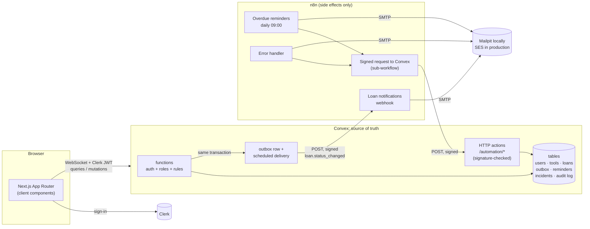
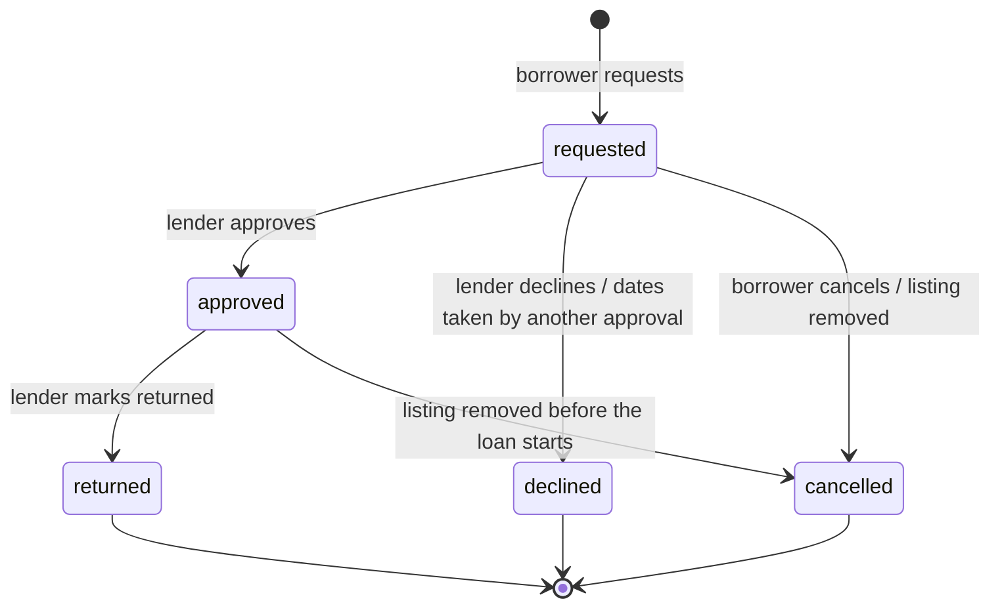
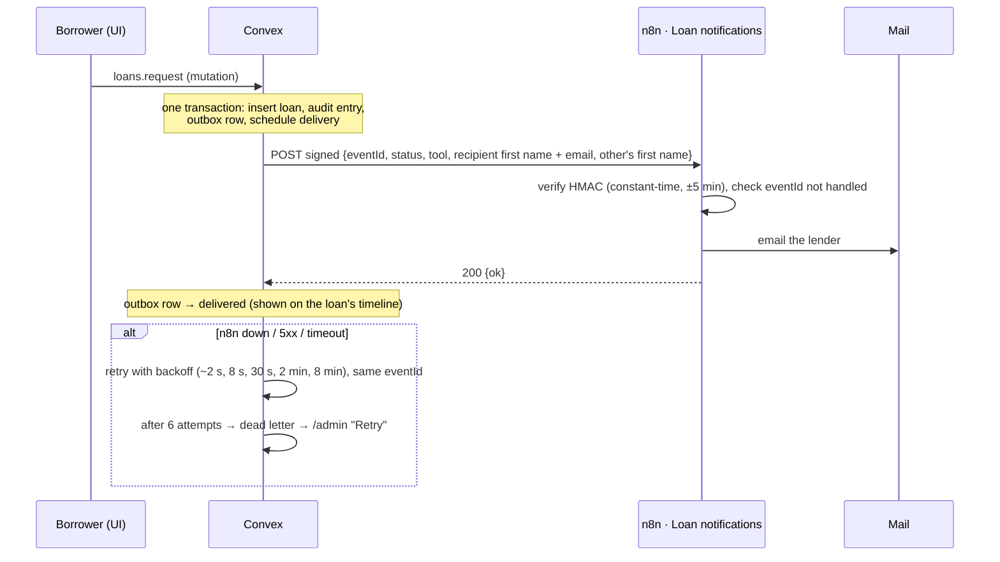
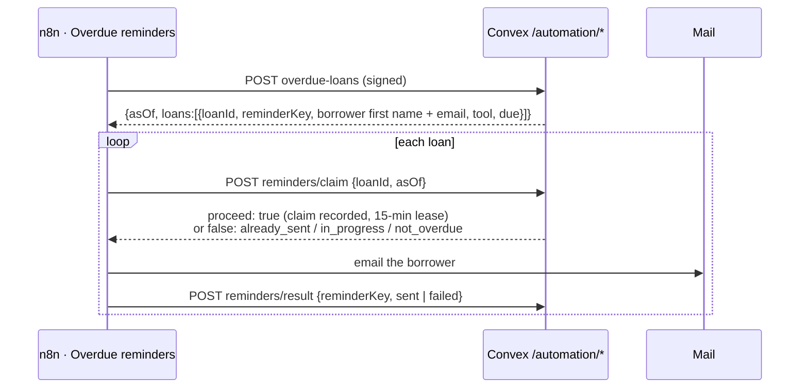

# LendLoop

**Borrow what you need. Lend what you don't.**

A neighborhood tool-lending board. Neighbors list tools, request them for a date range, approve or decline requests and mark returns. n8n handles the notifications and the overdue reminders.

**Stack:** Next.js 16 (App Router) · Clerk · Convex · n8n 2.49 · TypeScript. Locally, Docker also runs self-hosted Convex and a Mailpit inbox.

- **Quick start:** `npm run setup`, then `npm run dev`. It needs Docker and a free Clerk dev app ([details below](#quick-start)).
- **Production notes:** [PRODUCTION.md](PRODUCTION.md) is the short note on what I'd change to run this in production.
- **Verification:** 43 Convex tests, plus a 21-check smoke test against the live stack, including real scheduled and failing n8n runs. CI boots the whole stack on every push to main and every pull request, and also checks the CSP, scans the history for secrets and runs CodeQL.

---

## Contents

1. [Quick start](#quick-start)
2. [The brief, point by point](#the-brief-point-by-point)
3. [Architecture](#architecture)
4. [Roles and access control](#roles-and-access-control)
5. [Automation with n8n](#automation-with-n8n)
6. [Security and data minimization](#security-and-data-minimization)
7. [Environment variables](#environment-variables)
8. [Testing](#testing)
9. [Project layout](#project-layout)
10. [Trade-offs and what I'd do next](#trade-offs-and-what-id-do-next)

---

## Quick start

**You need:** Node 22+, Docker, and a Clerk application (free; [dashboard.clerk.com](https://dashboard.clerk.com) → Create application → Email). Neighbors see each other by first name, so turn on _First and last name_ in the app's user settings. Without it, sign-up asks only for an email and everyone appears as "Neighbor".

```bash
npm ci   # exact versions from the lockfile; no install scripts run (see .npmrc)

# 1. Your Clerk keys (Clerk dashboard → API keys). Stored in .env.local, which is git-ignored.
node scripts/set-clerk-keys.mjs publishable pk_test_...
node scripts/set-clerk-keys.mjs secret sk_test_...

# 2. Everything else. This generates local secrets, starts Docker (Convex, n8n,
#    task runner, Mailpit), imports and publishes the n8n workflows, and deploys
#    the Convex functions.
#    --clerk-jwt-template creates the "convex" JWT template in your Clerk dev
#    instance (see "Clerk ↔ Convex" below for the alternative).
npm run setup -- --clerk-jwt-template

# 3. Optional: a demo neighborhood with four neighbors, eight tools, one pending
#    request and one overdue loan.
npm run seed

# 4. Run the app (Next.js plus the Convex watcher)
npm run dev
```

Sign in at <http://localhost:3000>, then make yourself an admin:

```bash
npm run make-admin -- you@example.com
```

| What                             | Where                                                                                   |
| -------------------------------- | --------------------------------------------------------------------------------------- |
| The app                          | <http://localhost:3000>                                                                 |
| n8n editor                       | <http://localhost:5678>. Setup prints the login; the password is also in `docker/.env`. |
| Mailpit (every email lands here) | <http://localhost:8025>                                                                 |
| Convex dashboard                 | <http://localhost:6791>. Log in with `CONVEX_SELF_HOSTED_ADMIN_KEY` from `.env.local`.  |

Useful commands:

- `npm run stack:up` / `stack:down` / `stack:logs` manage the Docker stack.
- `npm run smoke` runs the end-to-end check.
- `npm run check` runs types, lint, tests and the workflow-secrets check.
- `npm run stack:destroy -- --yes` removes everything LendLoop put on your machine: containers, volumes, images and the generated secret files.

Running a stranger's take-home is a risk in itself, so this repo is built to be safe to run. Everything listens only on your own machine (loopback), nothing runs at install time, and every image is pinned. See [Your machine and the supply chain](#your-machine-and-the-supply-chain).

To try a loan end to end you need two accounts: lender and borrower. A second browser profile works, or Clerk test emails (`anything+clerk_test@example.com`, verification code `424242`).

### Clerk ↔ Convex

Convex accepts a Clerk token only when its issuer matches `CLERK_FRONTEND_API_URL` and its audience is `convex`. There are two ways to get that:

- **`--clerk-jwt-template`** (used above). Setup calls Clerk's Backend API and creates a JWT template named `convex` with only four claims: `aud`, `given_name`, `email` and `email_verified`. `ConvexProviderWithClerk` uses it automatically.
- **Clerk's Convex integration.** Open the [Convex integration page](https://dashboard.clerk.com/apps/setup/convex) and choose _Activate Convex integration_. Then add these claims under _Sessions → Customize session token_:

  ```json
  {
    "given_name": "{{user.first_name}}",
    "email": "{{user.primary_email_address}}",
    "email_verified": "{{user.email_verified}}"
  }
  ```

`npm run setup` reads the issuer from your publishable key, so you never paste it. If you sign in and the board says the session wasn't accepted, one of these two steps is missing.

### Why Convex runs in Docker here

The two halves of the integration have to reach each other: Convex calls n8n's webhook, and n8n calls Convex's HTTP endpoints. With both on one compose network, that works offline on any OS with no tunnel. To use Convex Cloud instead, run `npx convex dev` against your project and set the same env vars there. Then expose n8n with a public URL (n8n Cloud or a tunnel) and set `LENDLOOP_CONVEX_SITE_URL_FOR_N8N` in `docker/.env` to your `.convex.site` URL.

---

## The brief, point by point

**Public page**

| Requirement                                                                 | Where                                                                                                 |
| --------------------------------------------------------------------------- | ----------------------------------------------------------------------------------------------------- |
| Company name and tagline                                                    | `app/page.tsx`                                                                                        |
| Read-only list of available tools: name and category only, no owner details | `tools.listPublic` returns `{name, category}`, with no ids. Test: _"see only the name and category"_. |
| "Sign in to lend or borrow" button wired to Clerk                           | `components/public/auth-action.tsx` (Clerk modal)                                                     |

**Signed-in users**

| Requirement                                                      | Where                                                                                                               |
| ---------------------------------------------------------------- | ------------------------------------------------------------------------------------------------------------------- |
| List a tool with name, category, condition and short description | `tools.create`, `tool-form-dialog.tsx`                                                                              |
| Request a tool for a date range                                  | `loans.request`, `request-dialog.tsx`. Booked dates are shown and the request is validated client- and server-side. |
| Approve or decline requests on your own tools                    | `loans.approve` / `loans.decline`                                                                                   |
| Mark a loan as returned                                          | `loans.markReturned` (by the lender)                                                                                |
| All tools with availability status, filterable by category       | `/tools`. The category filter is an indexed Convex query; there's also name search.                                 |
| "My listings", "My requests", "Incoming requests"                | `/listings`, `/borrowing`, `/lending`                                                                               |
| Nice, minimal layout                                             | Small custom component set: native `<dialog>`, real form controls, live updates over Convex                         |

**Roles**

| Requirement                                                            | Where                                                                    |
| ---------------------------------------------------------------------- | ------------------------------------------------------------------------ |
| Admin can remove any listing, view all loans, and mark Trusted Lenders | `convex/admin.ts`, `/admin`                                              |
| User can only touch their own listings, requests and loans             | Checked in every Convex function; see [Roles](#roles-and-access-control) |
| Enforced in Convex, not only in the UI                                 | `convex/model/functions.ts` (custom function builders). 12 access tests. |

**Automation with n8n**

| Requirement                                                          | Where                                                                                                              |
| -------------------------------------------------------------------- | ------------------------------------------------------------------------------------------------------------------ |
| Request notification when a request is created or changes status     | Convex outbox → signed webhook → `LendLoop · Loan notifications`. Sends minimal fields.                            |
| Daily overdue reminders that fetch from Convex, send, and write back | `LendLoop · Overdue reminders`. Claim → send → write back.                                                         |
| HMAC-signed payloads, verified on both sides                         | Standard Webhooks, with one secret per direction. See [Signing](#signing-protocol).                                |
| Secrets in env and n8n credentials, never in code or JSON            | `docker/.env` (generated) plus n8n Crypto and SMTP credentials. `npm run check:workflows` enforces it in CI.       |
| Idempotent write-backs                                               | `reminderKey = loanId:date` with a claim lease; incident keys; event ids                                           |
| Retries and an error workflow; nothing fails silently                | Convex retries and dead-letters; node retries; `LendLoop · Error handler` → ops email plus an incident on `/admin` |
| (Bonus) Automation activity on each loan                             | A timeline on every loan card, e.g. "Overdue reminder sent · 2 days ago"                                           |

**Deliverables**

| Requirement                                                                                        | Where                             |
| -------------------------------------------------------------------------------------------------- | --------------------------------- |
| Repo, exported workflow JSON, README with setup, env, architecture, security and data minimization | This repo; `n8n/workflows/*.json` |
| Production note                                                                                    | [PRODUCTION.md](PRODUCTION.md)    |

---

## Architecture



**Who does what**

- **Convex owns every rule.** Identity, roles, ownership, date validation, overlap checks, rate limits and the loan state machine all live in Convex functions. Anything that changes a loan writes an audit entry and queues its notification in the same transaction.
- **n8n only does side effects:** composing and sending messages, and the daily schedule. It never decides who may do what. It asks Convex (overdue list, reminder claim) and reports back (result, incident).
- **Next.js is a thin, reactive client.** Pages are client components on live Convex queries, so another neighbor's approval shows up without a refresh. A server layout redirects signed-out visitors (`auth.protect()` behind `<Suspense>`, as Cache Components requires), but that is a convenience: the data is guarded in Convex.

### Data model

| Table                 | Purpose                 | Notes                                                                                                               |
| --------------------- | ----------------------- | ------------------------------------------------------------------------------------------------------------------- |
| `users`               | One row per Clerk user  | First name, verified email, role, Trusted Lender date. Nothing else.                                                |
| `tools`               | Listings                | Soft-deleted (`status: removed`) so loan history and audit stay intact                                              |
| `loans`               | Requests and loans      | `requested → approved → returned`, or `→ declined / cancelled`. `lenderId` is denormalized for one-read "incoming". |
| `outbox`              | Convex → n8n deliveries | Attempts, backoff, dead letter. Holds no personal data; the payload is built at send time.                          |
| `reminders`           | n8n write-backs         | Unique `reminderKey = loanId:date`, claim lease, status, redacted error                                             |
| `automationIncidents` | n8n failures            | Keyed by execution id, resolvable by admins                                                                         |
| `auditLog`            | Who changed what        | Ids and short codes only, never personal data                                                                       |

Dates are whole days stored as `YYYY-MM-DD`: they sort as strings and carry no time zone. "Today" and "overdue" are evaluated in one configured zone, `LENDLOOP_TIMEZONE`, which the n8n schedule also uses.



---

## Roles and access control

Every public Convex function is built with one of five builders in `convex/model/functions.ts`. Authentication and role checks therefore live in one place and can't be left out of a handler.

| Builder                        | Who                         | Gives the handler                                  |
| ------------------------------ | --------------------------- | -------------------------------------------------- |
| `publicQuery`                  | anyone                      | nothing; only `tools.listPublic` uses it           |
| `userQuery` / `userMutation`   | signed-in, provisioned user | `ctx.viewer` (their `users` row)                   |
| `adminQuery` / `adminMutation` | `role === "admin"`          | `ctx.viewer`; the role is re-checked on every call |

| Action                                               | Visitor | User              | Admin                                                                                   |
| ---------------------------------------------------- | ------- | ----------------- | --------------------------------------------------------------------------------------- |
| See available tools (name and category)              | ✅      | ✅                | ✅                                                                                      |
| See all tools with owner first name and availability |         | ✅                | ✅                                                                                      |
| Create a listing                                     |         | ✅ (rate limited) | ✅                                                                                      |
| Edit or delete a listing                             |         | own only          | own only                                                                                |
| Remove any listing                                   |         |                   | ✅ (audited, with a reason)                                                             |
| Request a tool                                       |         | not your own      | not your own                                                                            |
| Approve, decline, mark returned                      |         | as lender only    | as lender only                                                                          |
| Cancel a request                                     |         | as borrower only  | as borrower only                                                                        |
| View all loans, users, automation health, audit log  |         |                   | ✅                                                                                      |
| Mark Trusted Lender                                  |         |                   | ✅ (audited)                                                                            |
| Grant admin                                          |         |                   | **nobody from the app**: `npm run make-admin` (internal function, needs the deploy key) |

A few details that matter:

- **Roles come from Convex,** not from the client or a JWT claim. `users.ensure` always creates new users as `user`.
- **Admins can be required to use a second factor** (`LENDLOOP_ADMIN_REQUIRE_MFA`, on in production). The check sits in the same builders as the role check. See [Security](#security-and-data-minimization).
- **Hidden existence:** someone outside a loan gets `NOT_FOUND`, not `FORBIDDEN`, so loan ids can't be probed.
- **Server-side checks:** dates, lengths, overlaps and state transitions are all checked on the server. The UI repeats some checks only so people see problems early.

---

## Automation with n8n

| Workflow                     | Trigger                                      | What it does                                                                                                                                                                              |
| ---------------------------- | -------------------------------------------- | ----------------------------------------------------------------------------------------------------------------------------------------------------------------------------------------- |
| **Loan notifications**       | Webhook `POST /webhook/lendloop/loan-events` | Verifies the signature against the raw bytes, drops repeated deliveries, composes and sends the email, replies 200. Replies 401 on a bad signature and 500 on failure, so Convex retries. |
| **Overdue reminders**        | Schedule, daily 09:00                        | Fetches overdue loans from Convex, claims each reminder, emails the borrower, then writes back `sent` or `failed`                                                                         |
| **Signed request to Convex** | Called by the other workflows                | One place that signs and POSTs to Convex, with retries                                                                                                                                    |
| **Error handler**            | Any failed production execution              | Redacts the error, emails the ops inbox, records an incident in Convex (shown on `/admin`)                                                                                                |

### Request notification



### Overdue reminders



### Signing protocol

Both directions follow [Standard Webhooks](https://www.standardwebhooks.com):

```
webhook-id:        evt_<outbox id> (Convex → n8n) or msg_<uuid> (n8n → Convex)
webhook-timestamp: unix seconds; more than 5 minutes off either way is rejected (replay window)
webhook-signature: v1,<base64 HMAC-SHA256(secret, "<id>.<timestamp>.<raw body>")>
```

- **Separate secret per direction.** A leaked n8n credential can't forge Convex's events, and the reverse holds too.
- **Raw-byte verification.** n8n checks the signature against the raw request bytes (the webhook's `rawBody` option), not a re-serialized copy. The compare is constant-time.
- **Secrets stay out of the workflows.** The HMAC runs in n8n's Crypto node using a **credential** (encrypted with `N8N_ENCRYPTION_KEY`). It never appears in the workflow, in env vars n8n exposes to nodes (`$env` stays blocked) or in execution data.
- **Convex verifies in `crypto.subtle.verify`**, which is constant-time. It also checks the body size (16 KB cap) before parsing, the body's `type` against the endpoint (a signed body can't be replayed elsewhere), and the body shape against a Convex validator.
- **Key rotation:** Convex also accepts `LENDLOOP_N8N_TO_CONVEX_SECRET_PREVIOUS`, and verifiers accept multiple space-separated signatures.
- **Interoperability is tested:** signatures round-trip with the reference `standardwebhooks` library in both directions.

### Reliability: what happens when things break

| Failure                                  | What happens                                                                                                                      | Where you see it                           |
| ---------------------------------------- | --------------------------------------------------------------------------------------------------------------------------------- | ------------------------------------------ |
| n8n down, 5xx, 408/429 or timeout (10 s) | Convex retries with exponential backoff and jitter, 6 attempts, same event id                                                     | Loan timeline: "retrying (attempt 3)"      |
| Still failing after 6 attempts           | Dead letter; an admin can **Retry** once it's fixed                                                                               | `/admin` → Automation                      |
| n8n replies 4xx (e.g. bad secret)        | No retry (it's a configuration bug); dead letter immediately                                                                      | `/admin` → Automation                      |
| Email server down while notifying        | Send Email node retries 3×. Then the workflow fails, the webhook returns 500 (Convex retries later) and the error workflow fires. | Ops email + `/admin` incident              |
| Email fails while reminding              | That loan's reminder is written back as `failed` with a redacted reason; others continue. The next run retries it.                | `/admin` → failed reminders, loan timeline |
| n8n crashes mid-reminder                 | The claim expires after 15 min and the next run takes it over                                                                     |                                            |
| A Convex call from n8n times out         | HTTP node retries 3×; every endpoint is idempotent                                                                                |                                            |
| n8n not configured at all                | Notifications are recorded as `skipped`, never silently dropped                                                                   | `/admin` counter, loan timeline            |

**Idempotency:**

- **Reminders:** `reminderKey = loanId:asOf` is unique. A claim is refused when that key was already sent or is being sent (15-minute lease). `sent` is terminal, so a late `failed` can't undo it, and replaying a result is a no-op. Overlapping runs and retries can't email a borrower twice in one day.
- **Notifications:** the event id is the outbox row id and stays the same across retries. n8n records handled ids in workflow static data (kept 7 days) after the email is sent and skips repeats. One narrow window remains: n8n saves static data when the execution ends, a few milliseconds after it responds, so a redelivery inside that window would slip through. Convex's first retry comes at least 1.6 s later. See [PRODUCTION.md](PRODUCTION.md) for closing it fully.
- **Incidents:** keyed by n8n execution id.

---

## Security and data minimization

**Identity and authorization**

1. **Authorization lives in Convex,** in shared builders, and is tested per role (`tests/convex/access.test.ts`). The UI hides what you can't do; the server refuses it.
2. **No path from the app to admin.** Roles live in the Convex `users` table and change only through an internal function that needs the deployment's admin key. New users are always `user`.
   - **Admins can be required to use a second factor.** Set `LENDLOOP_ADMIN_REQUIRE_MFA=true` on the Convex deployment. Then every admin function, in the same builder that checks the role, also refuses a session that hasn't passed a second factor (Clerk's `fva` claim), with `MFA_REQUIRED`. The admin page explains how to turn it on.
   - It's **off locally**, so reviewers don't need MFA set up, and on in [production](PRODUCTION.md). It needs Clerk's Convex integration (a session token), because a JWT template can't carry `fva`.
3. **Only verified emails are stored** (`email_verified` from Clerk). Notifications never go to an unproven address.

**What leaves Convex, and what's stored**

4. **Public data is minimal.** Signed-out visitors get tool **name and category** and nothing else: no ids, owners, descriptions or dates. The response shape is checked by a `returns` validator.
5. **First names only between neighbors.** The other party in a loan sees your first name. Emails are visible only to admins (to tell two "Sams" apart) and to the notification workflow.
6. **n8n receives only what each message needs.** Notification payloads carry the recipient's first name and email, the other person's first name, the tool name and the dates. They never include last names, descriptions, internal user ids or the other person's email. The overdue list carries the same minimum for reminders.
7. **The outbox holds no personal data.** Payloads are built at send time from current records, so a changed email is used and nothing is duplicated into a queue.
8. **Errors are redacted before storage.** Email addresses in SMTP or n8n errors become `[email]`, and messages are capped in length (reminders and incidents).
9. **Short execution retention.** Workflows that touch personal data keep _no_ successful executions (`saveDataSuccessExecution: none`) and keep failed ones for 7 days (`EXECUTIONS_DATA_MAX_AGE=168`), long enough to debug.
10. **The audit log stores ids, not people:** actor id, action, target id and a short machine-readable detail. It is also **tamper-evident**:
    - **How:** every entry carries a sequence number, the previous entry's hash and its own SHA-256 over all of that. Editing, deleting or reordering an entry breaks the chain from that point. Re-hashing one edited entry doesn't help either, because the next entry still points at the old hash.
    - **Where it's checked:** `/admin` re-verifies the latest 500 entries on every load and says where the chain breaks. `npx convex run admin:verifyAuditChain` checks all of it, page by page.
    - **The limit:** it detects tampering; it doesn't prevent it. Someone with the deploy key could rewrite every entry after the one they changed, or drop the newest ones. Production closes that by copying the latest hash somewhere they can't write ([PRODUCTION.md](PRODUCTION.md)).

**Secrets**

11. **Generated, never committed, least privilege.** `npm run setup` generates every secret into `docker/.env`. Those secrets reach only the containers that need them. They're kept out of the repo root because Next.js would load a root `.env`.
12. **Inside n8n, secrets live in credentials** (encrypted at rest). `N8N_BLOCK_ENV_ACCESS_IN_NODE` stays `true` (n8n 2.x's secure default), so workflows can't read the environment. The workflow JSON references credentials by id only. `npm run check:workflows` (in CI) fails if a secret value, credential data, static data or owner info ever appears in `n8n/workflows/`. `npm run n8n:export` strips those fields on export.
13. **Clerk keyless mode is disabled,** so the app never silently creates a throwaway Clerk instance.

**Hardening**

14. **Abuse limits.** Per-user token-bucket rate limits on creating listings and requesting loans (`@convex-dev/rate-limiter`, evaluated inside the transaction). Length limits and control-character stripping on all text. Loans are capped at 30 days and at most 180 days ahead.
15. **A strict Content-Security-Policy.** A script runs only if it carries the nonce generated for that request, or was loaded by one that does (`'strict-dynamic'`). An injected `<script>` or `onclick=` therefore doesn't run, whatever host it points at. Clerk's middleware sets the policy in strict mode (its default would allow inline scripts and any `https:` host). Next.js puts the nonce on its own scripts, so every page renders per request: a page prerendered at build time couldn't carry one. Connections go only to the Convex deployment and Clerk. `frame-ancestors 'none'`, `object-src 'none'` and `base-uri 'self'` are also set. One allowance remains: inline _styles_, which Clerk's components need. The other headers are `nosniff`, a strict referrer policy, a locked-down Permissions-Policy, and HSTS in production.
16. **n8n runs with only what these workflows use.** The nodes that run shell commands or read and write the container's files are excluded (`NODES_EXCLUDE`). Installing community packages from the editor is off, and so is the public REST API. The editor needs a login (bcrypt hash in env; no setup screen), and n8n telemetry is off.

### Your machine and the supply chain

A take-home runs on someone's own computer, next to their real accounts and keys. So the repo treats the reviewer's machine as part of the threat model, not just the app.

17. **Nothing is reachable from your network.** Every Docker port binds to `127.0.0.1`. `npm run dev` and `npm start` bind to `localhost` (`-H localhost`), because Next.js otherwise listens on every interface. It's `localhost` rather than `127.0.0.1` because Next.js must see the same host name the browser uses. With a mismatch, it treats Clerk's same-page rewrite as another site and proxies it, and every page fails.
18. **Containers get no privileges.** Every service drops all Linux capabilities and runs with `no-new-privileges`. The only host folders mounted are two folders of this repo, read-only.
19. **The code-execution sandbox is cut off.** n8n's task runner, which runs the workflows' Code nodes, sits on an internal Docker network with a read-only filesystem and memory and process limits. Probed from inside: external DNS fails, the internet and the Docker host are unreachable, and so are Convex and Mailpit. The n8n broker is all it can reach.
20. **You run exactly what was tested.** Images are pinned by digest, npm packages by lockfile (`npm ci`), and CI actions by commit SHA.
21. **No third-party code runs at install time.** `.npmrc` sets `ignore-scripts`. Install scripts are how compromised npm packages usually attack developers, as the Shai-Hulud worm did. The only dependency here with one is esbuild, and it works without it. CI checks every installed package against the registry (`npm run check:signatures`): its npm signature, plus its Sigstore publish and build-provenance attestations where it has them. A failure names the package and npm's reason on the run page. It runs on Node 26's npm, because npm before 11.11 aborts when a package's attestations arrive as keyless provenance only. When it went red on 2026-11-25, nothing had been tampered with: both packages it flagged (`napi-postinstall`, `convex-helpers`) have attestations that match Sigstore's public log exactly. The causes were that npm limitation and a race in npm's verifier on a cold cache, absorbed by one retry that can't pass a forged signature (details in [`scripts/check-signatures.mjs`](scripts/check-signatures.mjs)).
22. **CI has nothing worth stealing.** It runs with a read-only token, doesn't keep git credentials after checkout, uses no secrets and no dependency cache, and has job timeouts. Dependabot keeps the pins current but waits until a release is a week old, since most malicious releases are pulled within days.
23. **CI also looks for mistakes:**
    - **Secrets:** Gitleaks scans every commit in the history for secrets. Its three allowances, each hand-checked, are in [`.gitleaks.toml`](.gitleaks.toml).
    - **Code:** CodeQL scans the TypeScript and the workflow files themselves with its `security-extended` queries. That job's token can upload results and nothing else.
    - **The CSP:** `npm run check:csp` serves the production build and fails if any page's policy stops being nonce-strict.

    How to report a vulnerability: [SECURITY.md](SECURITY.md).

24. **Patched as of 2026-11-25.** n8n 2.49.5 includes the fix for every n8n security advisory published so far, and `npm audit --omit=dev` reports no known vulnerabilities in the app's dependencies.
25. **A clean exit.** `npm run stack:destroy -- --yes` removes the containers, volumes, images and generated secrets, then lists what only you can revoke (the Clerk app and any git token).

---

## Environment variables

Every variable is documented in [`.env.example`](.env.example). Nothing has to be filled in by hand except the two Clerk keys.

| Variable                                                                                            | Lives in                    | Secret       | Purpose                                                |
| --------------------------------------------------------------------------------------------------- | --------------------------- | ------------ | ------------------------------------------------------ |
| `NEXT_PUBLIC_CLERK_PUBLISHABLE_KEY`                                                                 | `.env.local`                | no           | Clerk frontend                                         |
| `CLERK_SECRET_KEY`                                                                                  | `.env.local`                | **yes**      | Clerk middleware; optional JWT-template creation       |
| `NEXT_PUBLIC_CONVEX_URL`                                                                            | `.env.local`                | no           | Convex client (`http://127.0.0.1:3210`)                |
| `CONVEX_SELF_HOSTED_URL` / `_ADMIN_KEY`                                                             | `.env.local`                | key: **yes** | Convex CLI → local backend                             |
| `CLERK_FRONTEND_API_URL`                                                                            | Convex env                  | no           | Issuer Convex trusts; derived from the publishable key |
| `LENDLOOP_APP_URL`                                                                                  | Convex env                  | no           | Links in emails                                        |
| `LENDLOOP_TIMEZONE`                                                                                 | Convex env + `docker/.env`  | no           | What "today" means; n8n schedule zone                  |
| `N8N_LOAN_EVENTS_WEBHOOK_URL`                                                                       | Convex env                  | no           | Where Convex sends loan events                         |
| `LENDLOOP_CONVEX_TO_N8N_SECRET`                                                                     | Convex env + n8n credential | **yes**      | Signs Convex → n8n                                     |
| `LENDLOOP_N8N_TO_CONVEX_SECRET` (`_PREVIOUS`)                                                       | Convex env + n8n credential | **yes**      | Signs n8n → Convex (rotation)                          |
| `LENDLOOP_ADMIN_REQUIRE_MFA`                                                                        | Convex env                  | no           | `true`: admin functions need a second factor (prod)    |
| `N8N_ENCRYPTION_KEY`, `N8N_RUNNERS_AUTH_TOKEN`, `CONVEX_INSTANCE_SECRET`, `N8N_OWNER_PASSWORD_HASH` | `docker/.env`               | **yes**      | Infrastructure                                         |
| `LENDLOOP_REMINDER_SCHEDULE`                                                                        | shell, for `npm run setup`  | no           | Test hook: a cron schedule for the reminder workflow   |

The Convex variables are declared and typed in `convex/convex.config.ts`. A deploy fails if a required one is missing, and code reads them through the typed `env`, never `process.env` (an ESLint rule enforces this).

---

## Testing

| Command                         | What it covers                                                                                                                                                                                                     |
| ------------------------------- | ------------------------------------------------------------------------------------------------------------------------------------------------------------------------------------------------------------------ |
| `npm test`                      | **43 Convex tests** (convex-test, edge runtime), listed below                                                                                                                                                      |
| `npm run check:csp`             | After `npm run build`: every page's CSP is nonce-strict and every script carries the nonce                                                                                                                         |
| `npm run smoke`                 | **14 checks against the running stack** (needs no Clerk), listed below                                                                                                                                             |
| `npm run smoke -- --workflows`  | **7 more**: the reminder and error workflows run for real inside n8n (CI runs this)                                                                                                                                |
| `npm run check`                 | Types, lint (including Convex's ESLint rules), tests and the workflow-secrets check                                                                                                                                |
| CI (`.github/workflows/ci.yml`) | All of the above, a production build and its CSP, the npm signature check, a secret scan of the git history, then the full Docker stack with `setup`, `seed` and `smoke --workflows`. CodeQL runs in `codeql.yml`. |

**What the Convex tests cover:**

- Every role rule: visitor, unprovisioned, owner vs non-owner, every admin function refused for users, and the admin second-factor switch.
- The audit hash chain: it verifies, and an edited, deleted or re-hashed entry is caught at the right place.
- Input cleaning and rate limits.
- The loan state machine, including overlaps and auto-declines.
- Availability and overdue logic.
- Data minimization in views and payloads.
- Outbox delivery, retries, dead letters and the admin retry.
- Every signed endpoint: unsigned, wrong key, stale, tampered, cross-endpoint, oversized, rotation.
- The full reminder claim, send and write-back cycle and its idempotency.
- Incident recording.
- Standard Webhooks interop with the reference library.

**What the smoke test does:** it plays Convex against the live n8n webhook (unsigned, wrong key, replayed, tampered, valid, redelivered: exactly one email reaches Mailpit), then plays n8n against the live Convex endpoints.

**With `--workflows`** it also lets n8n do the work, as production executions:

- **A real scheduled reminder run.** The run claims the seeded overdue loan, emails the borrower and writes back `sent`. A later run sends nothing more: one email, one attempt.
- **A real failure.** The test stops Mailpit and sends a valid event. The notification run fails with a 5xx (so Convex would retry), the error workflow fires, and the incident appears in Convex with the node named and no email address.

It needs the demo data and a one-minute reminder schedule, which is a test hook in the n8n bootstrap. In CI that looks like this:

```bash
LENDLOOP_REMINDER_SCHEDULE="* * * * *" npm run setup
npm run seed
npm run smoke -- --workflows
```

**Also verified by hand on the running stack:** the whole loop in the browser as two Clerk test users. A lender lists a tool and a borrower requests it, and the lender gets the email. The lender approves, and the borrower gets the email. The lender marks it returned, and the borrower gets a receipt. Each step shows on the loan's activity timeline. Then the admin page: marking a Trusted Lender, and the audit log.

---

## Project layout

```
app/                     Next.js routes: public page, sign-in/up, (board)/{tools,listings,borrowing,lending,admin}
components/              UI: board shell + nav, tools, loans (with automation timeline), admin console, ui/*
convex/
  schema.ts              tables and indexes
  convex.config.ts       typed env + rate-limiter component
  model/functions.ts     publicQuery / userQuery / adminMutation … (auth lives here)
  tools.ts loans.ts      user-facing functions
  admin.ts users.ts      admin capabilities, user provisioning
  automation.ts          outbox delivery, overdue list, reminder claim/result, incidents (internal)
  http.ts                signed HTTP endpoints for n8n
  model/signing.ts       Standard Webhooks sign/verify (Web Crypto)
  seed.ts                optional demo data (internal)
n8n/workflows/           exported workflow JSON (no secrets; checked in CI)
n8n/bootstrap/           imports credentials + workflows into n8n on `docker compose up`
docker/compose.yml       Convex backend + dashboard, n8n + task runner, Mailpit
scripts/                 setup, teardown, smoke test, workflow export/check, CSP and npm-signature checks, make-admin
tests/convex/            convex-test suites
.github/workflows/       ci.yml (checks, signatures, secret scan, full stack), codeql.yml
SECURITY.md              how to report a vulnerability
```

---

## Trade-offs and what I'd do next

- **Self-hosted Convex locally, Convex Cloud in production.** Self-hosted makes the n8n ↔ Convex loop work offline on any machine. Nothing in the code depends on which one runs.
- **Email via SMTP to Mailpit.** It's real email locally, so you can read exactly what each person receives. In production the same SMTP credential points at SES.
- **A custom outbox instead of the Convex Workpool component.** The outbox gives each loan its visible delivery history and a dead-letter queue with a Retry button, which I wanted on the admin page.
- **Notification dedupe in n8n static data.** It's simple and has no extra moving parts, with the narrow window described above. Reminders, where a duplicate would nag someone, use the stronger Convex-side claim.
- **Next:**
  - Clerk Organizations for real multi-tenant B2B roles.
  - Deleting a person's data through a Clerk `user.deleted` webhook.
  - Playwright end-to-end tests using Clerk testing tokens.
  - Moving notification dedupe to a Convex claim (as reminders do).

Running this for real is covered in **[PRODUCTION.md](PRODUCTION.md)**.
